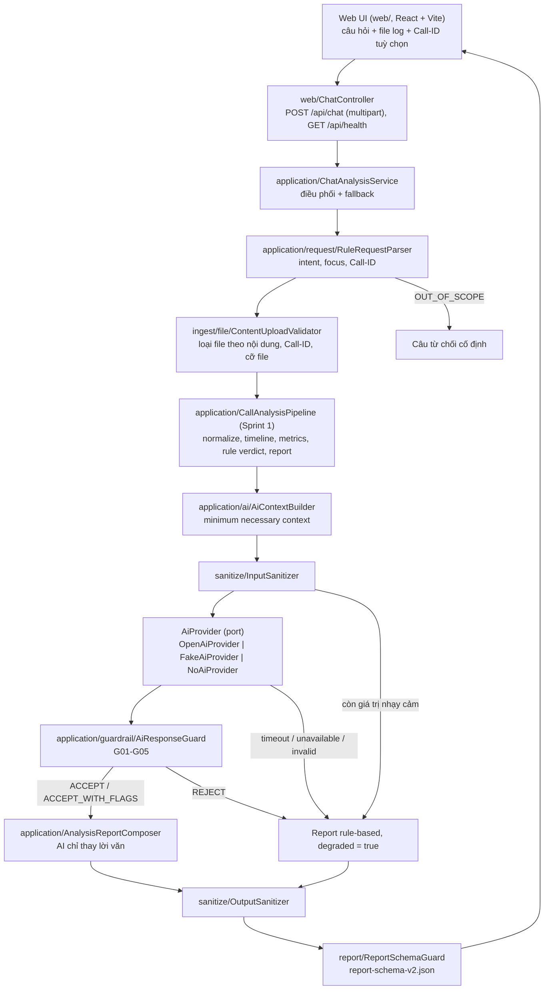
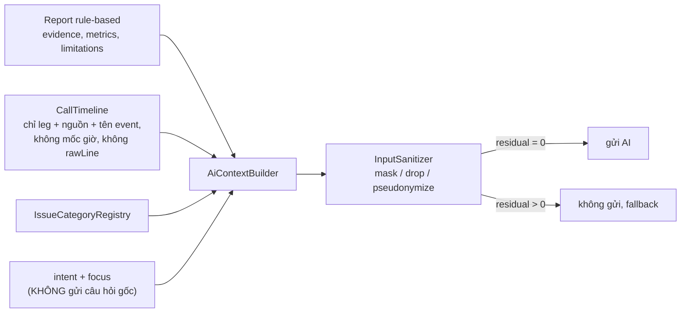

# Architecture Diagram v2 (Sprint 2)

Cập nhật từ `architecture-diagram-v1.md`: thêm Web UI, Chat API, File Validator, Request Parser,
Input/Output Sanitizer, AI Analysis, Guardrails, Fallback và Evaluation Runner. Phần pipeline
rule-based của Sprint 1 **không đổi** - nó trở thành baseline mà AI phải qua Guardrails để được
dùng. Tên package là tên thật trong `src/main/java/com/tutran/callassistant/`.

## Luồng một lượt hỏi trên Web UI

Mọi nhánh lỗi của AI (chưa cấu hình, timeout, trả lời hỏng, bị Guardrails từ chối, context chưa
sạch) đều rơi về cùng một chỗ: report rule-based đánh dấu `degraded`. AI không bao giờ làm hỏng request.

## Phân vai code và AI (PROJECT_SPEC.md mục 3.2)

| Thành phần | Do ai | Ghi chú thực tế |
| --- | --- | --- |
| Chỉ số, evidence, issue category, cờ chất lượng, độ tin cậy | Code | `AnalysisReportComposer` luôn lấy từ report rule-based |
| Verdict | Rule đề xuất, AI đối chiếu | Lệch nhau → `UNKNOWN`, độ tin cậy `LOW`, kèm cờ G04 |
| Summary, analysis, suggestions | AI (sau Guardrails) | Số liệu và evidence ID bị kiểm bằng code (G01, G05) |
| Bố cục report | Code | `TextReportRenderer` / `ReportView.tsx`, AI chỉ điền field |
| Intent, focus | Code (từ khoá) | Bản AI chưa làm - xem Known Limitations |

## Dữ liệu đi sang AI

Câu hỏi gốc của người dùng và `rawLine`/`attributes` của event **không bao giờ** nằm trong context, nên
văn bản tự do và các khối SDP/JSON nhúng không phải là đường rò rỉ.

## Thành phần mới theo package

| Package | Nội dung |
| --- | --- |
| `web/` | `ChatController`, `ApiExceptionHandler` (lỗi thân thiện, đã sanitize) |
| `application/` | `ChatAnalysisService`, `AnalysisReportComposer`, `ChatRequest/Response`, `CallAnalysisDetail` |
| `application/request/` | `RequestParser`, `RuleRequestParser`, `Intent`, `CallFocus` |
| `application/validation/` + `port/out/UploadValidator` | File Validator (hợp đồng) |
| `application/ai/` | `AiContextBuilder`, `AiPromptFactory`, `TimeLimitedAiCaller`, `AiProviderException` |
| `application/guardrail/` | `AiResponseGuard`, `GuardDecision`, `AiAnalysis` |
| `application/port/out/AiProvider` | Cổng ra tới AI |
| `ai/` | Adapter: `openai/OpenAiProvider`, `FakeAiProvider`, `NoAiProvider`, `AiConfiguration` |
| `sanitize/` | `SensitiveDataSanitizer` (engine), `InputSanitizer`, `OutputSanitizer`, `Pseudonymizer`, `logging/*` |
| `ingest/file/` | `ContentUploadValidator`, `UploadWorkspace`, `CallIdExtractor`, `CallDirectoryIndex`, `TreeSignalingSource` |
| `evaluation/` | `EvaluationRunner`, `MetricsCalculator`, `CaseLoader`, `CaseMaterializer`, `EvaluationReportWriter` |
| `cli/EvaluateCommand` | `evaluate --cases ... --data-root ...` |
| `web/` (thư mục gốc repo) | Web UI React + Vite + TypeScript |

Quy tắc phụ thuộc một chiều của Sprint 1 vẫn giữ: `application` chỉ biết interface (`AiProvider`,
`UploadValidator`), các adapter (`ai/`, `ingest/`, `web/`, `cli/`) nằm ngoài.
