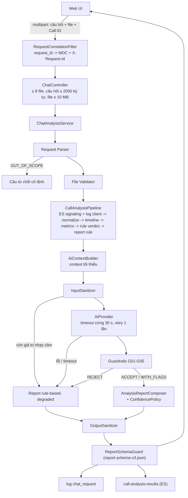

# Architecture & Security Design

Tài liệu bàn giao số 1 (PROJECT_SPEC.md mục 7.4). Nội dung: kiến trúc, luồng dữ liệu, phân vai code / AI, chính
sách sanitizer, taxonomy, catalog chỉ số, chiến lược prompt, API và Report Schema. Đây là bản gom cuối Sprint 3;
tài liệu chi tiết từng phần được dẫn link ở mỗi mục. Tên class, package, file trong tài liệu này là tên thật trong
repo.

---

## 1. Tổng quan

Người dùng hỏi bằng tiếng Việt trên Web UI và đính kèm log cuộc gọi (End Call log, WebRTC log). Hệ thống tự lấy
signaling của cuộc gọi từ Elasticsearch local, chạy pipeline **rule-based xác định**, rồi nhờ AI viết phần phân
tích. Kết quả là một report có bố cục cố định (mục 4.5): kết luận, evidence trích dẫn được về dòng log gốc, chỉ số,
nguyên nhân, đề xuất và giới hạn dữ liệu.

Ba quyết định thiết kế chi phối mọi thứ còn lại:

1. **Code tính, AI viết.** Mọi con số, evidence, verdict baseline và độ tin cậy do code tạo ra. AI chỉ được thay lời
   văn (tóm tắt, phân tích, đề xuất bổ sung), và lời văn đó bị kiểm bằng code trước khi tới người dùng.
2. **AI không bao giờ làm hỏng request.** Mọi lỗi AI (chưa cấu hình, timeout, trả lời hỏng, bị Guardrails từ chối,
   context chưa sạch) rơi về cùng một chỗ: report rule-based, đánh dấu `degraded`.
3. **Dữ liệu nhạy cảm không rời máy ở dạng gốc.** AI chỉ nhận context tối thiểu đã sanitize. Report, response, log
   và chỉ mục kết quả đều đi qua Output Sanitizer.

## 2. Kiến trúc

### 2.1. Thành phần (đối chiếu kiến trúc mục tiêu 3.1)

| Thành phần mục 3.1 | Class / package |
| --- | --- |
| Web UI tối giản | `web/` (React 18 + Vite + TypeScript) |
| Chat API | `web/ChatController` (`POST /api/chat`, `GET /api/health`), `web/RequestCorrelationFilter`, `web/ApiExceptionHandler` |
| Request Parser | `application/request/AiRequestParser` (rule từ khoá trước, AI chỉ cứu câu bị từ chối) + `RuleRequestParser` |
| File Validator | `ingest/file/ContentUploadValidator` (loại file theo **nội dung**, Call-ID, kích thước) |
| Data Loader | `application/SignalingSourceResolver` → `ingest/es/ElasticsearchSignalingSource` (+ dự phòng file); `ingest/file/DirectoryClientLogSource` |
| Log Normalizer | `ingest/file/{EndCallLogParser, WebRtcLogParser, SignalingExportParser}` → `domain/event/CanonicalEvent` |
| Timeline Builder | `analysis/timeline/TimelineBuilder` (khử trùng, neo thời gian WebRTC, xử lý lệch đồng hồ) |
| Evidence Engine + Rule Verdict | `analysis/verdict/RuleVerdictEngine` + chuỗi `VerdictRule` + `EvidenceEngine` |
| Metrics Calculator | `analysis/metrics/CallMetricsCalculator` |
| Input Sanitizer | `sanitize/InputSanitizer` (dùng `SensitiveDataSanitizer`) |
| AI Analysis Engine | `application/ai/{AiContextBuilder, AiPromptFactory, TimeLimitedAiCaller}` + port `AiProvider` → `ai/openai/OpenAiProvider` |
| Guardrails | `application/guardrail/AiResponseGuard` (G01-G05) |
| Output Sanitizer | `sanitize/OutputSanitizer`; log: `sanitize/logging/*` |
| Report Renderer | `report/TextReportRenderer` (văn bản) và `web/src/components/ReportView.tsx` (UI), cả hai từ cùng JSON đã validate |
| *(Sprint 3)* Confidence | `report/confidence/EvidenceBasedConfidencePolicy` |
| *(Sprint 3)* Explainability | `report/VerdictExplainer`, `report/SuggestionCatalog` |
| *(Sprint 3)* Observability | `application/RequestIds`, dòng log `chat_request` / `ai_call` / `es_query`, `sanitize/logging/SanitizingJsonLayout` |
| *(Sprint 3)* Kết quả cho Kibana | port `AnalysisResultArchive` → `ingest/es/ElasticsearchResultArchive` (index `call-analysis-results`) |

Phụ thuộc **một chiều** từ ngoài vào trong: adapter (`web`, `cli`, `ingest`, `ai`, `report`, `sanitize`) →
`application` → `analysis` → `domain`. `application` chỉ biết interface (port): `AiProvider`,
`SignalingEventSource`, `UploadValidator`, `AnalysisResultArchive`...

### 2.2. Luồng một lượt hỏi



### 2.3. Độ tin cậy

| Lớp | Cơ chế |
| --- | --- |
| AI | Hạn chót cứng `TimeLimitedAiCaller` 30 s, pool tối đa 16 lời gọi đồng thời; OpenAI timeout 12 s mỗi lần, retry 1 lần chỉ với lỗi tạm thời (timeout, 408/429/5xx); lỗi phân loại `TIMEOUT / UNAVAILABLE / INVALID_RESPONSE` |
| Elasticsearch | Connect 2 s, socket 5 s; lỗi phân loại `ES_UNAVAILABLE / ES_TIMEOUT / ES_INDEX_MISSING / ES_ERROR`; retry 1 lần chỉ với lỗi kết nối; không lấy được signaling thì nêu lý do trong "Giới hạn dữ liệu", không trả 500 |
| Input | Parser không crash với log hỏng / thiếu field / trùng / lệch thứ tự; file sai loại, sai Call-ID, hỏng, quá cỡ bị loại kèm lý do |
| Web UI | Timeout 90 s phía trình duyệt; mã fallback hiển thị bằng câu tiếng Việt; lỗi hiện kèm `request_id` |
| Ghi kết quả | Ghi ES thất bại chỉ log cảnh báo, không ảnh hưởng request |

### 2.4. Quan sát (observability)

Mỗi request HTTP có một `request_id` do server sinh. Nó nằm trong MDC (mọi dòng log), header `X-Request-Id`,
`ChatResponse.requestId` và `ApiError.requestId`.

Ba dòng log chuẩn, dạng `key=value`:

- `chat_request`: request_id, result, intent, call_id (pseudonym), verdict, issue_category, confidence, degraded,
  fallback_reason, warnings, latency_ms
- `ai_call`: request_id, call_id (pseudonym), model, latency_ms, result_status, token_usage, fallback_reason; có thêm
  dòng `purpose=intent` cho Request Parser
- `es_query`: index, hits, latency_ms, attempt, error_kind

Profile `jsonlog` ghi thêm `logs/app.jsonl`. Index `call-analysis-results` cùng dashboard Kibana
(`kibana/call-analysis-dashboard.ndjson`) cho thấy phân bố verdict, UNKNOWN rate, fallback rate, latency P50/P95
và lỗi.

## 3. Phân vai Code và AI (mục 3.2)

| Thành phần | Thực hiện bởi | Thực tế trong code |
| --- | --- | --- |
| Chỉ số cuộc gọi | Code | `CallMetricsCalculator`; thiếu dữ liệu thì `N/A` kèm lý do, không bao giờ mặc định 0 |
| Tín hiệu verdict, issue category, cờ chất lượng | Code (rule) | Chuỗi `VerdictRule`; mỗi rule khai báo tiêu chí (`criterion()`) để report giải thích được |
| Verdict cuối | AI đề xuất, Guardrails đối chiếu | Khớp rule → giữ. Lệch → `UNKNOWN`, cờ G04, độ tin cậy LOW, giải thích nêu AI đã đề xuất gì |
| Độ tin cậy | Code | `EvidenceBasedConfidencePolicy`; `confidenceLevel` AI trả về bị bỏ qua |
| Hiểu câu hỏi | Rule + AI | Rule từ khoá trước; AI chỉ được biến câu "ngoài phạm vi" thành "trong phạm vi", không bao giờ ngược lại; Call-ID luôn do regex trích |
| Phân tích, đề xuất | AI | `summary`, `analysis`, đề xuất **bổ sung** (đứng sau bộ đề xuất chuẩn) |
| Giải thích "vì sao kết luận" | Code | `VerdictExplainer`: chuyện gì xảy ra, vì sao, evidence nào, điều tra gì tiếp. Có cả khi AI lỗi |
| Bố cục report | Code | `TextReportRenderer` / `ReportView.tsx`; AI chỉ điền field theo schema |

### 3.1. Độ tin cậy (mục 7.2)

| Tín hiệu | Mức |
| --- | --- |
| Verdict `UNKNOWN`; evidence yếu (không có evidence, hoặc có vấn đề mà category `UNKNOWN`); AI lệch rule (G04) | **LOW** |
| Evidence chưa đủ mạnh (thiếu nguồn chính theo taxonomy, hoặc chỉ 1 dòng); thiếu file / dữ liệu; evidence không neo được thời gian tuyệt đối; report degraded (không có AI đối chiếu) | **MEDIUM** |
| Evidence mạnh (≥ 2 dòng, có nguồn chính) + đủ file + AI khớp rule (hoặc report thuần rule ở CLI) | **HIGH** |

Nguồn chính theo mục 4.2: packet loss / jitter → End Call; ICE → WebRTC hoặc End Call; TURN → WebRTC; signaling →
signaling hoặc End Call; SUCCESS sạch → signaling. Mọi tín hiệu kích hoạt được ghi vào `confidenceReasons` của report.

## 4. Chính sách sanitizer

Chi tiết từng field quan sát được trong data mẫu: `docs/sensitive-data-inventory.md`.

| Loại dữ liệu | Phân loại | Chính sách | Ví dụ kết quả |
| --- | --- | --- | --- |
| MOS, packet loss, RTT, jitter, thời lượng; ISP / ASN / country | INTERNAL | Allow | giữ nguyên |
| Số điện thoại (VN), email, IP client (v4/v6) | SENSITIVE | Mask | `[PHONE_REDACTED]`, `[EMAIL_REDACTED]`, `[IP_REDACTED]` |
| User ID, device ID, session ID / csid / requestId, TURN session | SENSITIVE | Pseudonymize (HMAC có salt, ổn định trong một lần chạy) | `USER_a81f2c`, `DEVICE_…`, `CALL_…` |
| JWT, Authorization header, API key, password / token, ICE ufrag/pwd, DTLS fingerprint | SECRET | Drop | `[REDACTED]` |
| Khối SDP, URL TURN server, chi tiết hạ tầng | SENSITIVE / INTERNAL | Minimize | cả khối SDP bị bỏ; `turn:[TURN_SERVER_REDACTED]` |

Áp dụng ở bốn chỗ:

1. **Input**, trước khi gửi AI (`InputSanitizer`). Context đã chỉ gồm dữ liệu tối thiểu: không có câu hỏi gốc,
   không có `rawLine` / `attributes` của event, timeline không có mốc giờ. Còn sót dù một giá trị thì không gửi
   (`INPUT_NOT_SANITIZED`).
2. **Output**: report, response, cảnh báo xử lý, thông báo lỗi (`OutputSanitizer`, `ApiExceptionHandler`).
3. **Application log**: converter `%san` / `%sanEx` cho console, `SanitizingJsonLayout` cho log JSON. Log AI call chỉ
   có field được phép (mục 6.2), không log raw AI request/response.
4. **Chỉ mục kết quả ES**: chỉ field tóm tắt, Call-ID dạng pseudonym, không có văn bản tự do.

Kiểm chứng: `docs/security-evaluation-report.md` (S01-S08, 0 leakage ở cả 3 lượt, kể cả khi AI cố tình rò rỉ).

## 5. Taxonomy

Chi tiết (definition, symptoms, required evidence, detection condition, known ambiguity):
`docs/verdict-issue-taxonomy.md`, nguồn trong code `analysis/verdict/IssueCategoryRegistry`.

| Verdict | Tiêu chí kiểm tra được |
| --- | --- |
| `SUCCESS` | Signaling đạt `OK_ACK_OK` (CONFIRMED) và kết thúc bằng `BYE`, không bị ngắt bất thường; cờ chất lượng khi chỉ số vượt ngưỡng |
| `FAIL` | Chấm dứt tường minh (`FAIL_HARD` / `CANCEL`) trước CONFIRMED; không bao giờ CONFIRMED; ICE của một bên failed; hoặc đã có media rồi bị ngắt bất thường |
| `UNKNOWN` | Không có signaling; không có log client nào; hoặc đã CONFIRMED nhưng không thấy kết thúc |

| Issue category | Điều kiện phát hiện chính (ngưỡng ở `application.yml`) |
| --- | --- |
| `NETWORK_PACKET_LOSS` | packet loss > 5% hoặc MOS < 3.5 ở một bên |
| `NETWORK_DELAY_JITTER` | jitter > 30 ms hoặc RTT > 300 ms |
| `ICE_FAILURE` | ICE failed / không đạt connected; hoặc PARTNER_LOST_NETWORK / ICE DISCONNECTED trước khi chính bên đó cúp máy, kèm không nhận audio |
| `TURN_FAILURE` | không tạo được socket TURN, hoặc gửi allocate mà không có phản hồi |
| `SIGNALING_FAILURE` | không CONFIRMED mà không có evidence ICE/TURN; chấm dứt tường minh ở tầng signaling |
| `NONE` / `UNKNOWN` | không có vấn đề / có vấn đề nhưng không quy được |

## 6. Catalog chỉ số (mục 4.3)

| Chỉ số trong report | Nguồn | Ghi chú |
| --- | --- | --- |
| Thời gian thiết lập (INIT_CALL → OK_ACK) | Signaling | |
| Thời gian với tới callee (INVITE → TRYING) | Signaling | |
| Số lần gửi lại INVITE, số lần "No sessions found" | Signaling | |
| Thời gian đổ chuông (RINGING → OK) | Signaling | |
| Thời lượng kết nối (OK_ACK → BYE) | Signaling | |
| Bên kết thúc, số lần gửi lại BYE | Signaling | |
| MOS thấp nhất, packet loss / RTT / jitter cao nhất (theo từng bên) | End Call | jitter quy đổi từ giây sang ms |
| Sự kiện ICE / TURN chính (theo từng bên) | WebRTC | |

Thiếu dữ liệu thì `N/A (lý do)`, không bao giờ 0. Giá trị tính tay để đối chiếu: `docs/metrics-hand-calculation.md`.
Các chỉ số "Nếu kịp" (khoảng trống PAIR_PING, latency API nội bộ, WARN/ERROR theo service, ISP/ASN theo leg) chưa
đưa vào report; xem Known Limitations trong `docs/final-evaluation-report.md`.

## 7. Chiến lược prompt

Chi tiết: `docs/prompt-strategy.md`. Nguồn: `src/main/resources/ai/prompts/analysis-system.vi.txt`,
`ai-output-schema-v1.json`.

- **Input** (`AiContextBuilder`): intent + focus, `ruleBaseline` (tắt được bằng
  `call-analysis.ai.include-rule-baseline=false`), evidence có ID, chỉ số đã tính, giới hạn dữ liệu, timeline rút
  gọn (≤ 80 mục, không mốc giờ), taxonomy. Hai cách dựng: `structured` (mặc định) hoặc `semi` (ít hơn 27% token,
  accuracy như nhau).
- **Output**: JSON schema strict: `verdict, qualityFlag, issueCategory, confidenceLevel, summary, evidenceIds,
  analysis, suggestions`.
- **Quy tắc prompt**: chỉ dựa vào input; evidence ID chỉ lấy từ danh sách; số liệu chép nguyên văn từ metrics /
  evidence; thiếu dữ liệu thì `UNKNOWN`; ưu tiên khía cạnh `focus`; phân tích trả lời 4 câu hỏi; tối đa 4 đề xuất;
  không nhắc định danh.
- **Tham số**: `gpt-4o-mini`, temperature 0, seed cố định, `response_format: json_schema strict`.
- **Không tin prompt**: mọi quy tắc trên được Guardrails kiểm lại bằng code:

| Mã | Kiểm | Khi vi phạm |
| --- | --- | --- |
| G01 | `evidenceIds` phải tồn tại | REJECT → fallback |
| G02 | JSON đúng schema, đủ field, không field lạ, không quá lớn | REJECT |
| G03 | verdict / issueCategory / confidence thuộc enum | REJECT |
| G04 | verdict / category / cờ chất lượng của AI khác rule | ACCEPT_WITH_FLAGS: verdict `UNKNOWN`, độ tin cậy LOW |
| G05 | Mọi con số trong lời văn phải có trong chỉ số / evidence | REJECT |

## 8. API

### `POST /api/chat` (multipart/form-data)

| Part | Bắt buộc | Mô tả |
| --- | --- | --- |
| `message` | không | Câu hỏi tiếng Việt, ≤ 2000 ký tự |
| `files` | không, ≤ 8 | `*_endcall.log`, `*_webrtc.log`; nhận diện theo nội dung; ≤ 10 MB mỗi file |
| `callId` | không | Cần khi chỉ đính kèm WebRTC log (loại log này không có Call-ID) |

Phản hồi 200 (`ChatResponse`):

```json
{
  "requestId": "req-1a2b3c4d",
  "intent": "ANALYZE_CALL | ANALYZE_WITH_FOCUS | OUT_OF_SCOPE",
  "focus": ["AUDIO_QUALITY"],
  "report": { "...": "Report v3, null khi OUT_OF_SCOPE" },
  "message": "câu từ chối cố định khi OUT_OF_SCOPE, ngược lại null",
  "degraded": false,
  "fallbackReason": "AI_TIMEOUT | AI_UNAVAILABLE | AI_INVALID_RESPONSE | AI_NOT_CONFIGURED | AI_ERROR | GUARDRAIL_REJECTED | INPUT_NOT_SANITIZED | OUTPUT_SCHEMA_INVALID | RULE_ONLY | null",
  "warnings": ["ghi chú xử lý đã sanitize"],
  "renderedText": "report dạng văn bản theo mẫu 4.5",
  "aiTokens": 3400
}
```

Lỗi (`ApiError`): `{"error": "thông báo tiếng Việt", "requestId": "req-…"}`. 400: quá 8 file, câu hỏi quá dài,
thiếu part. 413: file > 10 MB. 500: lỗi không dự kiến, đã sanitize. Mọi phản hồi có header `X-Request-Id`.

### `GET /api/health`

`{"status":"UP","ai":{"model":"gpt-4o-mini","configured":true},"elasticsearch":"UP|DOWN"}`

### CLI

`import`, `analyze`, `demo`, `evaluate`, `security-eval`, `batch`. Cách dùng: `docs/runbook.md`.

## 9. Report Schema v3

File: `src/main/resources/schema/report-schema-v3.json`. Record: `domain/report/Report`. Mọi report được validate
(`ReportSchemaGuard`) trước khi trả về. Report AI không hợp lệ thì thay bằng report rule-based
(`OUTPUT_SCHEMA_INVALID`).

| Field | Kiểu | Ai điền | Ghi chú |
| --- | --- | --- | --- |
| `callId` | string | code | |
| `verdict` | `SUCCESS` / `FAIL` / `UNKNOWN` | code (G04 có thể đổi thành `UNKNOWN`) | |
| `qualityFlag` | boolean | code | |
| `issueCategory` | 6 category của mục 4.2 + `NONE` | code | `NONE` = đã kiểm, không có vấn đề |
| `alternativeCauses` | string[] | code (taxonomy "known ambiguity") | dòng "Khả dĩ khác" |
| `confidenceLevel` | `HIGH` / `MEDIUM` / `LOW` | code | mục 3.1 ở trên |
| `confidenceReasons` | string[] | code | **v3** |
| `summary` | string | AI (fallback: rule) | |
| `evidence[]` | `{id: EV###, source, timestamp, description}` | code | AI chỉ đổi thứ tự (evidence được trích lên trước) |
| `explanation` | string[] | code | **v3**: 4 câu trả lời của mục 7.1 T2 |
| `analysis` | string | AI sau Guardrails | rỗng khi degraded / mâu thuẫn |
| `metrics[]` | `{name, value, source}` | code | |
| `suggestions` | string[] | code (bộ chuẩn) + AI (bổ sung) | tối đa 7 |
| `dataLimitations` | string[] | code | |
| `degraded` | boolean | code | |

Thay đổi so với v2: thêm `confidenceReasons` và `explanation`.
